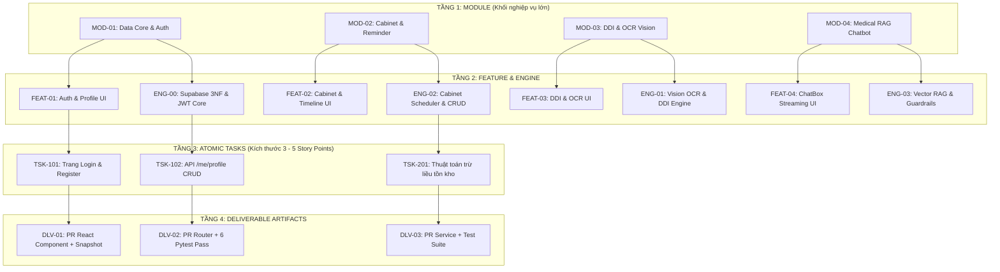
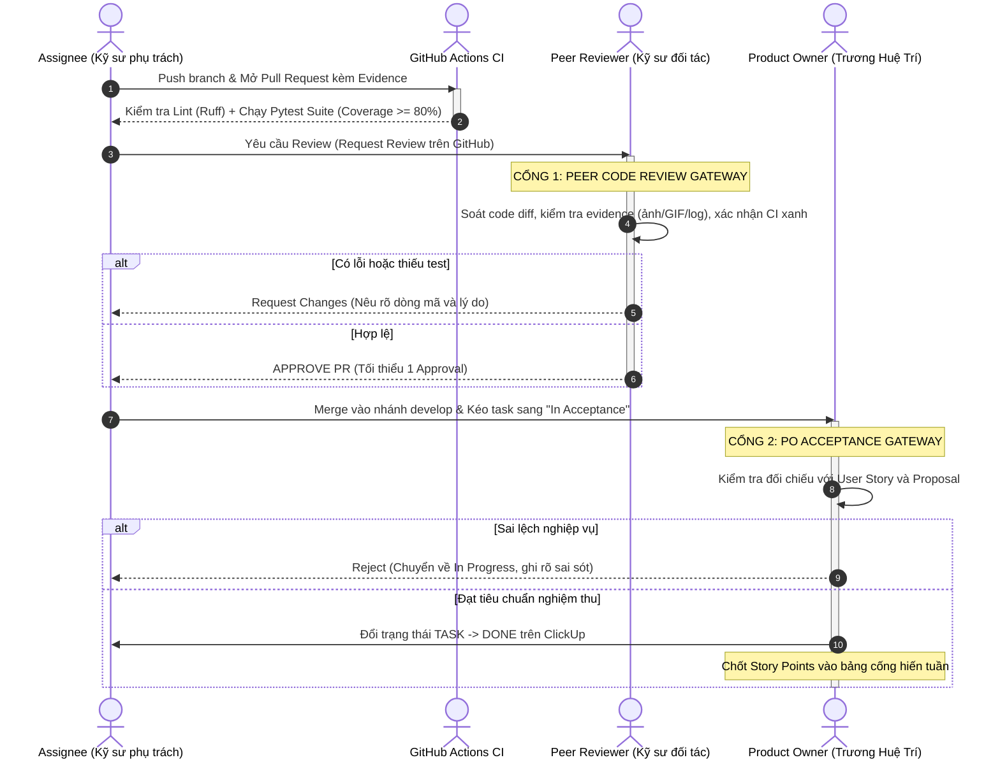
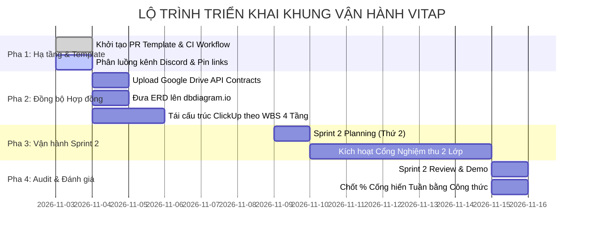

# Design Document: VitaP Operational & Spec Governance Harness

* **Status:** In Review (Drafting)
* **Author:** Trương Huệ Trí (PO & Data Core Lead) & VitaP Core Team
* **Date:** 2026-11-03
* **Target Release:** Sprint 2 / Semester 1, 2026-2027

---

## 1. Overview & Problem Statement

### 1.1 The Problem
Nhóm kỹ thuật VitaP (4 sinh viên) đang vận hành theo mô hình Scrum với chu kỳ 1 tuần nhưng gặp phải các điểm nghẽn nghiêm trọng cản trở tiến độ và chất lượng dự án:
1. **Thiếu tính rõ ràng trong phân rã nhiệm vụ:** Các đầu việc (tasks) được giao chỉ dừng lại ở tên gọi chung chung, thiếu mô tả đặc tả (Input/Output/Constraints) và không tuân thủ cấu trúc phân tầng nghiệp vụ đã cam kết trong Đề cương Proposal.
2. **Thiếu tiêu chuẩn nghiệm thu định lượng (Definition of Done - DoD):** Các thành viên không có căn cứ rõ ràng để xác định khi nào một task được coi là hoàn thành. Việc nghiệm thu bị phụ thuộc vào phán đoán cảm tính, dẫn đến bất đồng và rạn nứt niềm tin nội bộ.
3. **Đứt gãy và phân tán luồng giao tiếp:** Thông tin kỹ thuật bị trôi dạt giữa nhiều nền tảng (Discord, Google Drive, ClickUp, GitHub), gây lãng phí thời gian tra cứu và hiểu nhầm về hợp đồng dữ liệu (API Contracts / Schema).
4. **Bất cân xứng trách nhiệm và bất an về đóng góp:** Thiếu một cơ chế đánh giá cống hiến khách quan, có cơ sở toán học để phân định minh bạch % đóng góp của từng thành viên phục vụ đánh giá đồ án học phần.

### 1.2 Goals (In-Scope)
* **G1. Cấu trúc Phân rã 4 Tầng Thống nhất:** Chuẩn hóa toàn bộ hệ thống theo cấu trúc: `Module` (Tầng 1) $\rightarrow$ `Feature & Engine` (Tầng 2) $\rightarrow$ `Task` (Tầng 3) $\rightarrow$ `Deliverable` (Tầng 4).
* **G2. Bộ Tiêu chuẩn Nghiệm thu Tự động (Automated DoD Harness):** Thiết lập quy định cứng bắt buộc mọi Pull Request phải có kiểm thử tự động (Pytest), kiểm tra định dạng (Linting), và bằng chứng trực quan (UI Snapshot / CLI Log).
* **G3. Cơ chế Nghiệm thu 2 Lớp (Two-Tier Acceptance):** Phân định rạch ròi: Lớp 1 (Peer Review Approve) xác nhận chất lượng kỹ thuật mã nguồn; Lớp 2 (PO Done) nghiệm thu tính phù hợp nghiệp vụ trước khi đóng task trên ClickUp.
* **G4. Chuẩn hóa Phân luồng Kênh Giao tiếp:** Tối ưu hóa Discord thành kênh thông báo tự động bot (`#system`), kho liên kết tài nguyên chuẩn (`#resources`), và kênh trao đổi nghiệp vụ; định vị Google Drive là nơi lưu trữ văn bản hợp đồng kỹ thuật bất biến.
* **G5. Công thức Đo lường % Cống hiến Khách quan:** Áp dụng mô hình định lượng kết hợp 3 thành phần: Khối lượng hoàn thành Story Points (45%), Bằng chứng kỹ thuật Git/CI (25%), và Đánh giá đồng cấp ẩn danh 360 độ (30%).

### 1.3 Non-Goals (Out-of-Scope)
* **NG1. Không xây dựng hệ thống phần mềm quản lý chấm điểm tự động ngoài luồng:** Toàn bộ công thức cống hiến được tính toán định kỳ qua Google Sheets / ClickUp có sẵn, không lập trình thêm công cụ bên ngoài.
* **NG2. Không áp đặt công cụ trả phí:** Tuyệt đối không sử dụng bất kỳ dịch vụ hay phần mềm có thu phí nào (toàn bộ vận hành trên GitHub Free, ClickUp Free, Discord, Google Drive, Supabase/Render Free Tier).
* **NG3. Không can thiệp vào quy trình Git nội bộ của cá nhân:** Chỉ kiểm soát chất lượng tại cổng Pull Request vào nhánh chính (`develop` / `main`), không kiểm soát số lượng commit nháp trên nhánh tính năng cá nhân.

---

## 2. Technical Plan & Operational Architecture

### 2.1 Kiến trúc Phân Tầng Vận Hành (4-Tier Governance Architecture)

Toàn bộ hệ thống quản lý công việc và mã nguồn được ánh xạ chặt chẽ theo cấu trúc 4 tầng:



* **Quy chuẩn mã hóa (Taxonomy Invariant):**
  - Mọi Pull Request, branch Git và ticket ClickUp bắt buộc phải chứa tiền tố Tầng 3 và Tầng 4 (ví dụ: `feat/tsk-102-profile-crud`).
  - Tầng 1 và Tầng 2 được định hình bất biến từ đầu dự án; hàng tuần nhóm chỉ phân rã và nghiệm thu ở Tầng 3 và Tầng 4.

---

### 2.2 Quy Trình Nghiệm Thu 2 Lớp (Two-Tier Acceptance Protocol)

Một Task trên ClickUp chỉ được chuyển trạng thái sang **DONE** khi thỏa mãn đồng thời hai cổng kiểm soát tuần tự:



---

### 2.3 Phân Luồng Giao Tiếp & Lưu Trữ Đa Kênh

Để triệt tiêu tình trạng trôi dạt thông tin và quá tải thông báo:

1. **Phân Luồng Kênh Discord:**
   - `#system` (Bot & Webhook Read-Only): Kết nối GitHub Webhook, tự động bắn thông báo khi có PR mở mới, CI bị lỗi, hoặc có commit merge vào nhánh chính. Tuyệt đối không chat thảo luận tại đây.
   - `#resources` (Read-Only): Ghim cố định 3 liên kết sống còn:
     1. Link Google Drive chứa Hợp đồng dữ liệu (`api_contracts.docx`).
     2. Link trực quan CSDL trên `dbdiagram.io`.
     3. Link bảng theo dõi Sprint trên ClickUp.
   - `#general`: Kênh sinh hoạt chung, thông báo lịch họp, đăng bài Daily Standup bất đồng bộ hàng ngày trước 09:30 sáng.
   - Kênh nhánh chuyên biệt (`#mod-core`, `#mod-ui`, `#mod-ai`): Thảo luận chi tiết kỹ thuật theo từng module cụ thể, bắt buộc đính kèm code snippet hoặc ảnh chụp lỗi.

2. **Google Drive làm Kho Hợp Đồng Bất Biến (Contract Hub):**
   - Mọi tài liệu đặc tả API (`api_contracts.docx`) và Sơ đồ CSDL (`database_erd.docx`) lưu tại thư mục gốc `01_Architecture_Data_Contracts/`.
   - Bất kỳ thay đổi nào về trường dữ liệu (thêm/sửa cột) đều phải được cập nhật trên file Docs này trước khi viết code backend hoặc frontend.

---

### 2.4 Mô Hình Toán Học Đo Lường % Cống Hiến Học Thuật (Academic Contribution Model)

Để đảm bảo tính khách quan và minh bạch khi nộp báo cáo đánh giá thành viên cho giảng viên cuối kỳ, tỷ lệ phần trăm cống hiến ($C_i$) của thành viên $i$ trong một Sprint được tính theo công thức:

$$C_i = \frac{Score_i}{\sum_{k=1}^{4} Score_k} \times 100\%$$

Trong đó, tổng điểm thành phần $Score_i$ bao gồm 3 trụ cột độc lập:

$$Score_i = 0.45 \cdot \Phi_{SP}(i) + 0.25 \cdot \Phi_{ENG}(i) + 0.30 \cdot \Phi_{PEER}(i)$$

1. **Trụ cột 1: Chỉ số Hoàn thành Khối lượng ($\Phi_{SP}$ - 45%):**
   $$\Phi_{SP}(i) = \frac{SP_{done, i}}{SP_{committed, i}} \times \left(\frac{SP_{done, i}}{\sum_{k=1}^4 SP_{done, k}} \times 4\right)$$
   - Đánh giá mức độ hoàn thành cam kết Story Points ban đầu đã được PO nghiệm thu (Done).
   - Nếu không hoàn thành cam kết ($SP_{done} < SP_{committed}$), chỉ số sẽ bị giảm tương ứng theo tỷ lệ thiếu hụt.

2. **Trụ cột 2: Chỉ số Bằng chứng Kỹ nghệ Git/CI ($\Phi_{ENG}$ - 25%):**
   $$\Phi_{ENG}(i) = \min\left(10, \; 3 \cdot PR_{merged} + 2 \cdot PR_{reviewed} + 2 \cdot DoD_{pass\_rate} + 3 \cdot Test_{contrib}\right) / 10$$
   - Ghi nhận nỗ lực kỹ thuật có bằng chứng: PR được merge, công sức review chéo cho đồng đội, tuân thủ đúng checklist DoD và đóng góp test case kiểm thử.

3. **Trụ cột 3: Chỉ số Đánh giá Đồng cấp 360 độ ($\Phi_{PEER}$ - 30%):**
   - Đánh giá ẩn danh cuối tuần giữa 4 thành viên theo Form Rubric 5 tiêu chí (chuẩn ABET, thang điểm 1 - 5):
     1. Tính đúng hạn và mức độ giữ lời hứa cam kết.
     2. Chất lượng mã nguồn và sự cẩn trọng kỹ thuật.
     3. Thái độ hợp tác, lắng nghe và phản hồi tin nhắn.
     4. Tinh thần chủ động gỡ nghẽn (proactive blocker triage).
     5. Tuân thủ quy chuẩn tài liệu và quy trình nhóm.
   - **Cơ chế lọc nhiễu (Anti-Collusion):** Hệ thống tự động loại bỏ các phiếu đánh giá thiên vị cực đoan (cho toàn bộ 5/5 hoặc đánh giá lệch $> 2\sigma$ so với mức trung bình của nhóm mà không có bằng chứng minh chứng).

---

### 2.5 Lịch Trình Scrum 1 Tuần Rút Gọn (1-Week Cadence)

| Ngày | Khung giờ | Hoạt động chính | Địa điểm / Kênh | Mục tiêu nghiệm thu |
| :--- | :--- | :--- | :--- | :--- |
| **Thứ 2** | 20:00 - 20:45 | Sprint Planning & Contract Lock | Discord Voice | Phân bổ Task ClickUp, chốt hợp đồng API trên Drive. |
| **Thứ 3 - 6** | Trước 09:30 | Async Daily Standup | Discord `#general` | Báo cáo 3 mục: 1) Đã làm, 2) Sẽ làm, 3) Điểm nghẽn. |
| **Thứ 4** | 21:00 - 21:20 | Mid-Sprint Blocker Check | Discord Voice | Rà soát các PR bị kẹt, điều chuyển tải công việc nếu cần. |
| **Thứ 7** | 23:59 | Code Freeze & PR Cut-off | GitHub | Hạn chót mở PR để Peer Review; toàn bộ test phải xanh. |
| **Chủ Nhật** | 20:00 - 21:00 | Sprint Review & Retrospective | Google Meet | Demo sản phẩm, PO nghiệm thu, chốt bảng % cống hiến tuần. |

---

## 3. Alternatives Considered & Rejected

### 3.1 Chấm điểm Cống hiến Dựa trên Số Dòng Code (Lines of Code) hoặc Số lượng Commit
* **Mô tả:** Đánh giá % đóng góp dựa vào thống kê số dòng mã thêm/xóa (`git log --stat`) hoặc số commit trên GitHub.
* **Lý do loại bỏ:**
  - *Dễ bị thao túng (Gaming the system):* Thành viên có thể cố tình format code dài dòng, copy-paste thư viện hoặc chia nhỏ commit vô nghĩa để tăng điểm ảo.
  - *Không phản ánh giá trị kỹ nghệ:* Việc viết 50 dòng thuật toán tối ưu (như DDI Canonical Pair) có giá trị cao hơn nhiều việc viết 500 dòng code lặp boilerplate.

### 3.2 Quản trị Task Hoàn toàn trên GitHub Projects thay vì ClickUp
* **Mô tả:** Sử dụng bảng Kanban tích hợp sẵn của GitHub Projects thay vì dùng thêm nền tảng ClickUp.
* **Lý do loại bỏ:**
  - *Rào cản giao diện (Cognitive Overhead):* GitHub Projects phù hợp với theo dõi issue mã nguồn nhưng thiếu các trường quản lý tiến độ trực quan dạng bảng tính (spreadsheet view), khó thiết lập trường tính điểm Story Points và xuất báo cáo tiến độ tuần cho giảng viên học phần.
  - *Thói quen nhóm:* Nhóm đã thống nhất dùng ClickUp từ đầu để bám sát mô hình Scrum công nghiệp.

### 3.3 Cơ chế Nghiệm thu 1 Lớp (Single-Tier Review: Dev Merge Trực tiếp sau Peer Review)
* **Mô tả:** Cho phép kỹ sư tự merge PR vào nhánh chính ngay sau khi có 1 thành viên review Approve mà không cần qua cổng PO nghiệm thu.
* **Lý do loại bỏ:**
  - *Nguy cơ trôi lệch nghiệp vụ (Scope Drift):* Peer Reviewer thường chỉ soi xét về mặt cú pháp và chạy thử test case, dễ bỏ qua tính liên kết toàn cục và cam kết trong Proposal. Cần cổng gác của PO để bảo đảm tính thống nhất của toàn hệ thống trước khi đóng task.

### 3.4 Chu kỳ Sprint 2 Tuần thay vì 1 Tuần
* **Mô tả:** Giữ nhịp độ Scrum truyền thống 2 tuần cho mỗi vòng lặp phát triển.
* **Lý do loại bỏ:**
  - *Quá chậm so với tiến độ đồ án sinh viên:* Tổng thời gian thực hiện đồ án môn học chỉ kéo dài 8 tuần (khoảng 4 Sprint). Nếu dùng chu kỳ 2 tuần, một thành viên bị kẹt (blocker) sẽ làm mất tới 25% thời gian toàn kỳ trước khi được phát hiện tại buổi Retrospective. Chu kỳ 1 tuần giúp phát hiện và gỡ nghẽn ngay lập tức.

---

## 4. Implementation Plan & Rollout Roadmap

### 4.1 Lộ trình Triển khai 4 Giai đoạn (4-Phase Rollout)



### 4.2 Chi tiết Công việc & Tệp Cần Tạo / Chỉnh sửa

#### Bước 1: Khởi tạo Pull Request Template (`0_medicare/.github/pull_request_template.md`)
* **Tệp cần tạo:** `0_medicare/.github/pull_request_template.md`
* **Nội dung:** Bắt buộc người mở PR phải khai báo mã Task Tầng 3, Deliverable Tầng 4, tick checklist DoD (Lint, Test Coverage $\ge 80\%$), và đính kèm bằng chứng ảnh GIF / Terminal output.

```markdown
## 📌 Liên kết Task & Phân tầng
- Tầng 1 (Module): [MOD-01 / MOD-02 / MOD-03 / MOD-04]
- Tầng 3 (Task ClickUp): [Mã task, ví dụ: TSK-103]
- Tầng 4 (Deliverable): [Mã deliverable, ví dụ: DLV-103-PR]

## 🛠 Thay đổi Kỹ thuật Chính
- [Mô tả ngắn gọn 2-3 câu về logic nghiệp vụ đã bổ sung/sửa đổi]

## ✅ Bảng Kiểm tra Tiêu chí Nghiệm thu (DoD Checklist)
- [ ] Code tuân thủ linting (Ruff check pass).
- [ ] Bổ sung Unit Test / Integration Test đầy đủ.
- [ ] Toàn bộ CI Jobs trên GitHub Actions đều báo XANH (Green).
- [ ] Đã kiểm tra không gây hồi quy (Regression pass).

## 📸 Bằng chứng Nghiệm thu Kỹ thuật (Bắt buộc)
- **Ảnh / GIF / Terminal Output:**
  *(Dán bằng chứng chạy test thành công hoặc thao tác giao diện tại đây)*
```

#### Bước 2: Chuẩn hóa CI Test Workflow (`0_medicare/.github/workflows/ci.yml`)
* **Tệp cần chỉnh sửa:** `0_medicare/.github/workflows/ci.yml`
* **Nội dung:** Bổ sung job kiểm tra linting nhanh (`ruff check .`) và chạy `pytest` với báo cáo coverage. Giữ thời gian chạy CI $< 2$ phút.

#### Bước 3: Thiết lập Bảng tính Tính % Cống hiến trên Google Sheets
* **Vị trí lưu trữ:** Google Drive nhóm `02_Sprint_Harness_Weekly/Sprint_02_Contribution_Audit.xlsx`
* **Cột tính toán:**
  - `Member` | `Role`
  - `SP_Committed` | `SP_Done` $\rightarrow$ Tự động tính $\Phi_{SP}$
  - `PR_Merged` | `PR_Reviewed` | `DoD_Pass` $\rightarrow$ Tự động tính $\Phi_{ENG}$
  - `Peer_Score_Avg` $\rightarrow$ Tự động tính $\Phi_{PEER}$
  - `Total_Score` $\rightarrow$ Tự động quy đổi tỷ lệ phần trăm $C_i$ (Tổng = 100%).

---

### 4.3 Quản Lý Rủi Ro & Cơ Chế Phòng Ngừa (Risks & Mitigations)

| Rủi ro Kỹ thuật / Quy trình | Xác suất & Tác động | Giải pháp Phòng ngừa & Xử lý (Mitigation) |
| :--- | :---: | :--- |
| **Thành viên lúng túng khi viết Unit Test** | Trung bình / Cao | PO và Full Stack Lead cung cấp sẵn các mẫu test fixture chuẩn trong `tests/conftest.py` để copy dùng lại. |
| **Bất đồng ý kiến trong Peer Review kéo dài** | Thấp / Trung bình | Áp dụng quy tắc "Timebox 12h": Nếu sau 12h kể từ khi mở PR mà hai bên không thống nhất, PO có quyền can thiệp đưa ra quyết định cuối cùng. |
| **Điểm nghẽn bất khả kháng (ốm đau, thi cử)** | Trung bình / Cao | Báo cáo ngay tại buổi Standup sáng; kích hoạt quy tắc "Buffer 20%" tại Sprint Planning để điều chuyển bớt story points. |
