# 🗄️ TÀI LIỆU THIẾT KẾ CƠ SỞ DỮ LIỆU & BIỂU ĐỒ ERD (VITAP)

> **Dự án:** VitaP - Hệ thống Quản lý Dược phẩm & Trợ lý Y tế Thông minh  
> **Tác giả:** Trương Huệ Trí (`24120472`) - VT1 (PO & Data Core Lead)  
> **Mục tiêu:** Cung cấp tài liệu trực quan (Showcase), giải thích rõ nghiệp vụ dữ liệu và các mối quan hệ bảng chuẩn 3NF để toàn bộ thành viên trong nhóm (Frontend, Backend, AI) dễ dàng đối chiếu và tích hợp.

---

## 1. Thiết kế & Chuẩn Hóa 3NF

Cơ sở dữ liệu VitaP được thiết kế tuân thủ nghiêm ngặt **Dạng chuẩn 3 (3NF)** trên nền tảng Supabase (PostgreSQL), có cơ chế fallback mượt mà trên SQLite cục bộ.

### Ba nguyên tắc cốt lõi giải quyết bài toán dược lý:
1. **Phân tách Hoạt chất (`ActiveIngredient`) và Biệt dược (`BrandName`):**
   - *Vấn đề thực tế:* Một biệt dược có thể chứa nhiều hoạt chất (ví dụ: *Panadol Extra* gồm Paracetamol 500mg + Caffeine 65mg; *Alaxan* gồm Paracetamol 325mg + Ibuprofen 200mg).
   - *Giải pháp:* Tách riêng bảng biệt dược thương mại và hoạt chất gốc, kết nối qua bảng trung gian quan hệ N-N `drug_ingredients`. Nhờ đó, thuật toán tra cứu tương tác kiểm tra được triệt để từng hoạt chất ẩn, tránh bỏ sót rủi ro lâm sàng.
2. **Quy tắc Đối xứng chuẩn hóa Canonical Pair (`id_a < id_b`):**
   - *Vấn đề thực tế:* Cặp tương tác giữa Aspirin và Warfarin là hai chiều đối xứng. Nếu lưu cả (A, B) và (B, A) sẽ gây phình to CSDL và nguy cơ xung đột dữ liệu.
   - *Giải pháp:* Ràng buộc CSDL `ingredient_a_id < ingredient_b_id`. Mỗi cặp tương tác chỉ lưu đúng 1 dòng duy nhất, cho phép truy vấn Single-Shot Query với độ trễ cực thấp (< 3ms).
3. **Liên kết chặt chẽ Hồ sơ sức khỏe $\rightarrow$ Tủ thuốc $\rightarrow$ Tương tác:**
   - Người dùng lưu bệnh nền ICD-10 trong hồ sơ $\rightarrow$ Khi quét đơn thuốc hoặc chọn thuốc vào tủ, hệ thống tự động đối chiếu các quy tắc chống chỉ định bệnh nền (DCI) mà không cần nhập lại thông tin.

---

## 2. Biểu đồ ERD Tổng thể (Entity-Relationship Diagram)

```mermaid
erDiagram
    %% ==========================================
    %% 1. PHÂN HỆ TÀI KHOẢN & HỒ SƠ SỨC KHỎE (VT1)
    %% ==========================================
    USERS {
        int id PK "Khóa chính tự tăng"
        string phone UK "Số điện thoại đăng nhập (Unique)"
        string hashed_password "Mật khẩu băm Bcrypt an toàn"
        string full_name "Họ và tên người dùng"
        datetime created_at "Thời điểm tạo tài khoản"
    }

    PATIENT_PROFILES {
        int id PK "Khóa chính tự tăng"
        int user_id FK,UK "Khóa ngoại 1-1 trỏ về USERS"
        int yob "Năm sinh (tính độ tuổi)"
        string gender "Giới tính (MALE, FEMALE, OTHER)"
        text medical_conditions "Mảng JSON lưu mã ICD-10 bệnh nền"
        text drug_allergies "Mảng JSON lưu tên hoạt chất dị ứng"
        datetime updated_at "Thời điểm cập nhật hồ sơ gần nhất"
    }

    %% ==========================================
    %% 2. PHÂN HỆ DƯỢC LÝ & TƯƠNG TÁC THUỐC (VT1 & VT3)
    %% ==========================================
    ACTIVE_INGREDIENTS {
        int id PK "Khóa chính hoạt chất"
        string inn_name UK "Tên gốc quốc tế (Paracetamol, Aspirin...)"
        string atc_code "Mã phân loại ATC quốc tế"
        string drug_class "Phân nhóm dược lý điều trị"
    }

    BRAND_NAMES {
        int id PK "Khóa chính biệt dược"
        string brand_name "Tên thương phẩm (Panadol, Hapacol...)"
        string manufacturer "Nhà sản xuất (GSK, DHG Pharma...)"
        string dosage_form "Dạng bào chế (Viên nén, Viên sủi, Siro)"
    }

    DRUG_INGREDIENTS {
        int brand_id PK,FK "Khóa ngoại trỏ về BRAND_NAMES"
        int ingredient_id PK,FK "Khóa ngoại trỏ về ACTIVE_INGREDIENTS"
        string strength "Hàm lượng cụ thể (500mg, 10mg...)"
    }

    CONDITIONS {
        int id PK "Khóa chính bệnh nền"
        string icd10_code UK "Mã chuẩn ICD-10 (I10, E11, K25, Z33...)"
        string condition_name "Tên bệnh nền tiếng Việt"
    }

    DRUG_DRUG_INTERACTIONS {
        int id PK "Khóa chính tương tác DDI"
        int ingredient_a_id FK "Hoạt chất A (Ràng buộc: A < B)"
        int ingredient_b_id FK "Hoạt chất B"
        string severity "Mức độ rủi ro: RED / YELLOW / GREEN"
        text mechanism "Cơ chế tương tác dược lực / dược động học"
        text clinical_management "Hướng dẫn xử trí lâm sàng cho bệnh nhân"
    }

    DRUG_CONDITION_INTERACTIONS {
        int id PK "Khóa chính tương tác DCI"
        int ingredient_id FK "Hoạt chất chống chỉ định"
        int condition_id FK "Bệnh nền / Thai kỳ liên quan"
        string severity "Mức độ cảnh báo: RED / YELLOW"
        string contraindication_type "Chống chỉ định: ABSOLUTE / RELATIVE"
        text clinical_advice "Lời khuyên y khoa chi tiết"
    }

    %% ==========================================
    %% 3. PHÂN HỆ TỦ THUỐC & LỊCH NHẮC CỮ (VT2)
    %% ==========================================
    USER_CABINETS {
        int id PK "Khóa chính tủ thuốc"
        int user_id FK "Khóa ngoại người sở hữu"
        int brand_id FK "Khóa ngoại biệt dược trong CSDL (nếu có)"
        string custom_drug_name "Tên thuốc tự nhập (nếu ngoài danh mục)"
        int total_quantity "Tổng số lượng thuốc ban đầu"
        int remaining_quantity "Số lượng thuốc còn lại"
        datetime expiry_date "Hạn sử dụng"
    }

    MEDICATION_SCHEDULES {
        int id PK "Khóa chính lịch uống"
        int cabinet_id FK "Khóa ngoại trỏ về USER_CABINETS"
        string session "Buổi uống: MORNING / NOON / EVENING"
        string scheduled_time "Giờ uống cụ thể (ví dụ 07:00, 20:00)"
        float dosage "Liều lượng uống mỗi lần (viên/gói)"
        boolean is_active "Trạng thái kích hoạt nhắc nhở"
    }

    %% ==========================================
    %% CÁC QUAN HỆ & BẢN SỐ (CARDINALITY)
    %% ==========================================
    USERS ||--o| PATIENT_PROFILES : "1 User có 0 hoặc 1 Hồ sơ sức khỏe"
    USERS ||--o{ USER_CABINETS : "1 User có nhiều Thuốc trong Tủ"

    BRAND_NAMES ||--|{ DRUG_INGREDIENTS : "1 Biệt dược chứa 1 hoặc nhiều Hoạt chất"
    ACTIVE_INGREDIENTS ||--|{ DRUG_INGREDIENTS : "1 Hoạt chất có trong nhiều Biệt dược"

    ACTIVE_INGREDIENTS ||--o{ DRUG_DRUG_INTERACTIONS : "Ingredient A (Canonical A < B)"
    ACTIVE_INGREDIENTS ||--o{ DRUG_DRUG_INTERACTIONS : "Ingredient B"

    ACTIVE_INGREDIENTS ||--o{ DRUG_CONDITION_INTERACTIONS : "Hoạt chất tương tác"
    CONDITIONS ||--o{ DRUG_CONDITION_INTERACTIONS : "Bệnh nền liên quan"

    BRAND_NAMES ||--o{ USER_CABINETS : "Biệt dược chuẩn nạp vào Tủ thuốc"
    USER_CABINETS ||--o{ MEDICATION_SCHEDULES : "1 Thuốc trong tủ có nhiều cữ uống"
```



---

## 3. Từ Điển Dữ Liệu Chi Tiết (Data Dictionary)

### Bảng 1: `users` (Tài khoản người dùng)
* **Ý nghĩa nghiệp vụ:** Lưu trữ thông tin đăng nhập tối thiểu, bảo mật mật khẩu.
* **Mã file:** `backend/app/models/user_models.py`

| Tên Cột | Kiểu Dữ Liệu | Ràng Buộc | Ý Nghĩa Nghiệp Vụ |
| :--- | :--- | :--- | :--- |
| `id` | Integer | PK, Auto Increment | Định danh duy nhất của người dùng. |
| `phone` | String(15) | Unique, Not Null, Index | Số điện thoại dùng làm tên đăng nhập. |
| `hashed_password` | String(255) | Not Null | Mật khẩu đã băm bằng thuật toán Bcrypt. |
| `full_name` | String(100) | Nullable | Họ và tên hiển thị của người dùng. |
| `created_at` | DateTime | Default(UTC Now) | Ngày giờ đăng ký tài khoản. |

---

### Bảng 2: `patient_profiles` (Hồ sơ bệnh nền & Dị ứng)
* **Ý nghĩa nghiệp vụ:** Lưu thông tin cá nhân hóa y tế phục vụ cảnh báo DCI và tiêm vào System Prompt của Chatbot RAG.
* **Mã file:** `backend/app/models/user_models.py`

| Tên Cột | Kiểu Dữ Liệu | Ràng Buộc | Ý Nghĩa Nghiệp Vụ |
| :--- | :--- | :--- | :--- |
| `id` | Integer | PK, Auto Increment | Định danh hồ sơ. |
| `user_id` | Integer | FK(`users.id`), Unique | Khóa ngoại 1-1 liên kết với tài khoản. |
| `yob` | Integer | Nullable | Năm sinh (dùng tính tuổi để cảnh báo liều người già/trẻ em). |
| `gender` | String(10) | Default("OTHER") | Giới tính (`MALE`, `FEMALE`, `OTHER`). |
| `medical_conditions` | Text | Default("[]") | Mảng JSON các mã ICD-10 bệnh nền (ví dụ `["I10", "K25"]`). |
| `drug_allergies` | Text | Default("[]") | Mảng JSON tên hoạt chất dị ứng (ví dụ `["Aspirin", "Penicillin"]`). |
| `updated_at` | DateTime | OnUpdate(UTC Now) | Thời điểm cập nhật hồ sơ gần nhất. |

---

### Bảng 3: `active_ingredients` (Danh mục Hoạt chất gốc)
* **Ý nghĩa nghiệp vụ:** Lưu hoạt chất chuẩn hóa quốc tế (INN), là hạt nhân để kiểm tra tương tác thuốc.
* **Mã file:** `backend/app/models/drug_models.py`

| Tên Cột | Kiểu Dữ Liệu | Ràng Buộc | Ý Nghĩa Nghiệp Vụ |
| :--- | :--- | :--- | :--- |
| `id` | Integer | PK, Auto Increment | Định danh hoạt chất. |
| `inn_name` | String(255) | Unique, Not Null, Index | Tên hoạt chất quốc tế (Paracetamol, Ibuprofen...). |
| `atc_code` | String(10) | Nullable | Mã phân loại giải phẫu điều trị (ví dụ `N02BE01`). |
| `drug_class` | String(100) | Nullable | Nhóm dược lý (NSAID, ACEI, Statin, PPI...). |

---

### Bảng 4: `brand_names` (Biệt dược thương mại)
* **Ý nghĩa nghiệp vụ:** Lưu tên thuốc người dùng cầm trên tay hoặc mua ngoài hiệu thuốc Việt Nam.
* **Mã file:** `backend/app/models/drug_models.py`

| Tên Cột | Kiểu Dữ Liệu | Ràng Buộc | Ý Nghĩa Nghiệp Vụ |
| :--- | :--- | :--- | :--- |
| `id` | Integer | PK, Auto Increment | Định danh biệt dược. |
| `brand_name` | String(255) | Not Null, Index | Tên thương mại của thuốc (Panadol Extra, Hapacol...). |
| `manufacturer` | String(255) | Nullable | Hãng / Công ty dược sản xuất (GSK, DHG, Sanofi...). |
| `dosage_form` | String(50) | Nullable | Dạng bào chế (Viên nén, Viên sủi, Siro...). |

---

### Bảng 5: `drug_ingredients` (Thành phần & Hàm lượng thuốc)
* **Ý nghĩa nghiệp vụ:** Bảng quan hệ N-N kết nối Biệt dược với các Hoạt chất cấu thành.
* **Mã file:** `backend/app/models/drug_models.py`

| Tên Cột | Kiểu Dữ Liệu | Ràng Buộc | Ý Nghĩa Nghiệp Vụ |
| :--- | :--- | :--- | :--- |
| `brand_id` | Integer | PK, FK(`brand_names.id`, CASCADE) | Thuộc về biệt dược nào. |
| `ingredient_id` | Integer | PK, FK(`active_ingredients.id`, RESTRICT) | Chứa hoạt chất nào. |
| `strength` | String(50) | Nullable | Hàm lượng cụ thể (ví dụ: `500mg`, `65mg`). |

---

### Bảng 6: `conditions` (Danh mục Bệnh nền ICD-10)
* **Ý nghĩa nghiệp vụ:** Chuẩn hóa các bệnh lý mạn tính phổ biến và tình trạng sinh lý đặc biệt (Thai kỳ).
* **Mã file:** `backend/app/models/drug_models.py`

| Tên Cột | Kiểu Dữ Liệu | Ràng Buộc | Ý Nghĩa Nghiệp Vụ |
| :--- | :--- | :--- | :--- |
| `id` | Integer | PK, Auto Increment | Định danh bệnh nền. |
| `icd10_code` | String(10) | Unique, Not Null, Index | Mã quốc tế (I10: Tăng huyết áp, K25: Loét dạ dày, Z33: Mang thai...). |
| `condition_name` | String(255) | Not Null | Tên bệnh tiếng Việt mô tả rõ ràng. |

---

### Bảng 7: `drug_drug_interactions` (Luật Tương tác Thuốc - Thuốc)
* **Ý nghĩa nghiệp vụ:** Lưu trữ các cặp tương tác dược lý đã được kiểm chứng lâm sàng.
* **Mã file:** `backend/app/models/drug_models.py`

| Tên Cột | Kiểu Dữ Liệu | Ràng Buộc | Ý Nghĩa Nghiệp Vụ |
| :--- | :--- | :--- | :--- |
| `id` | Integer | PK, Auto Increment | Định danh luật tương tác. |
| `ingredient_a_id` | Integer | FK(`active_ingredients.id`), Not Null | ID hoạt chất A. **Bắt buộc `ingredient_a_id < ingredient_b_id`**. |
| `ingredient_b_id` | Integer | FK(`active_ingredients.id`), Not Null | ID hoạt chất B. |
| `severity` | String(10) | Not Null | Mức độ cảnh báo: `RED` (Nguy hiểm) / `YELLOW` (Thận trọng) / `GREEN` (An toàn). |
| `mechanism` | Text | Not Null | Cơ chế giải thích tương tác dược lý. |
| `clinical_management`| Text | Not Null | Khuyến cáo xử trí y khoa thực tế cho bệnh nhân. |

---

### Bảng 8: `drug_condition_interactions` (Chống chỉ định Thuốc - Bệnh nền)
* **Ý nghĩa nghiệp vụ:** Cảnh báo khi người có bệnh nền dùng phải thuốc làm bệnh nặng thêm.
* **Mã file:** `backend/app/models/drug_models.py`

| Tên Cột | Kiểu Dữ Liệu | Ràng Buộc | Ý Nghĩa Nghiệp Vụ |
| :--- | :--- | :--- | :--- |
| `id` | Integer | PK, Auto Increment | Định danh luật chống chỉ định. |
| `ingredient_id` | Integer | FK(`active_ingredients.id`), Not Null | Hoạt chất gây bất lợi. |
| `condition_id` | Integer | FK(`conditions.id`), Not Null | Bệnh nền chịu tác động. |
| `severity` | String(10) | Not Null | Mức độ: `RED` (Nguy kịch) / `YELLOW` (Cảnh báo). |
| `contraindication_type`| String(20) | Default("ABSOLUTE") | Loại chống chỉ định: `ABSOLUTE` (Tuyệt đối) / `RELATIVE` (Tương đối). |
| `clinical_advice` | Text | Not Null | Hướng dẫn chuyên môn y khoa. |

---

### Bảng 9: `user_cabinets` (Tủ thuốc cá nhân của người dùng)
* **Ý nghĩa nghiệp vụ:** Quản lý kho thuốc tại nhà của bệnh nhân, kết nối với dữ liệu từ OCR đơn thuốc.
* **Phân công phụ trách:** VT2 (Nguyễn Bảo Trọng)

| Tên Cột | Kiểu Dữ Liệu | Ràng Buộc | Ý Nghĩa Nghiệp Vụ |
| :--- | :--- | :--- | :--- |
| `id` | Integer | PK, Auto Increment | Định danh dòng thuốc trong tủ. |
| `user_id` | Integer | FK(`users.id`), Not Null | Thuốc này thuộc tủ của tài khoản nào. |
| `brand_id` | Integer | FK(`brand_names.id`), Nullable | Liên kết vào CSDL thuốc chuẩn (nếu tìm thấy). |
| `custom_drug_name` | String(255) | Nullable | Tên thuốc người dùng tự nhập (nếu thuốc ngoài danh mục). |
| `total_quantity` | Integer | Default(0) | Tổng lượng thuốc ban đầu (viên/gói/chai). |
| `remaining_quantity`| Integer | Default(0) | Lượng thuốc còn lại (tự động trừ khi uống). |
| `expiry_date` | Date | Nullable | Hạn sử dụng của thuốc. |

---

### Bảng 10: `medication_schedules` (Lịch nhắc cữ uống thuốc)
* **Ý nghĩa nghiệp vụ:** Xác định thời gian uống trong ngày để gửi cảnh báo 2 lớp (In-app + Web Push).
* **Phân công phụ trách:** VT2 (Nguyễn Bảo Trọng)

| Tên Cột | Kiểu Dữ Liệu | Ràng Buộc | Ý Nghĩa Nghiệp Vụ |
| :--- | :--- | :--- | :--- |
| `id` | Integer | PK, Auto Increment | Định danh cữ uống. |
| `cabinet_id` | Integer | FK(`user_cabinets.id`, CASCADE) | Thuộc về loại thuốc nào trong tủ. |
| `session` | String(20) | Not Null | Buổi uống: `MORNING` (Sáng), `NOON` (Trưa), `EVENING` (Tối). |
| `scheduled_time` | String(5) | Not Null | Giờ uống định dạng `HH:MM` (ví dụ `08:00`, `20:00`). |
| `dosage` | Float | Default(1.0) | Số lượng uống trong cữ đó (ví dụ: `1`, `0.5`, `2`). |
| `is_active` | Boolean | Default(True) | Trạng thái bật / tắt thông báo nhắc nhở cữ này. |


---

## 4. Mã Nguồn DBML Dành Cho dbdiagram.io (Interactive ERD)

> **Hướng dẫn:** Truy cập [https://dbdiagram.io](https://dbdiagram.io), tạo Diagram mới và dán toàn bộ đoạn mã bên dưới vào khung soạn thảo để xem và chỉnh sửa sơ đồ CSDL trực quan.

```dbml
Table users {
  id integer [pk, increment]
  phone varchar(15) [unique, not null]
  hashed_password varchar(255) [not null]
  full_name varchar(100)
  created_at timestamp [default: `now()`]
}

Table patient_profiles {
  id integer [pk, increment]
  user_id integer [unique, not null]
  yob integer
  gender varchar(10) [default: 'OTHER']
  medical_conditions text [default: '[]']
  drug_allergies text [default: '[]']
  updated_at timestamp
}

Table active_ingredients {
  id integer [pk, increment]
  inn_name varchar(255) [unique, not null]
  atc_code varchar(10)
  drug_class varchar(100)
}

Table brand_names {
  id integer [pk, increment]
  brand_name varchar(255) [not null]
  manufacturer varchar(255)
  dosage_form varchar(50)
}

Table drug_ingredients {
  brand_id integer [not null]
  ingredient_id integer [not null]
  strength varchar(50)

  indexes {
    (brand_id, ingredient_id) [pk]
  }
}

Table conditions {
  id integer [pk, increment]
  icd10_code varchar(10) [unique, not null]
  condition_name varchar(255) [not null]
}

Table drug_drug_interactions {
  id integer [pk, increment]
  ingredient_a_id integer [not null]
  ingredient_b_id integer [not null]
  severity varchar(10) [not null]
  mechanism text [not null]
  clinical_management text [not null]
}

Table drug_condition_interactions {
  id integer [pk, increment]
  ingredient_id integer [not null]
  condition_id integer [not null]
  severity varchar(10) [not null]
  contraindication_type varchar(20) [default: 'ABSOLUTE']
  clinical_advice text [not null]
}

Table user_cabinets {
  id integer [pk, increment]
  user_id integer [not null]
  brand_id integer
  custom_drug_name varchar(255)
  total_quantity integer [default: 0]
  remaining_quantity integer [default: 0]
  expiry_date date
}

Table medication_schedules {
  id integer [pk, increment]
  cabinet_id integer [not null]
  session varchar(20) [not null]
  scheduled_time varchar(5) [not null]
  dosage float [default: 1.0]
  is_active boolean [default: true]
}

Ref: patient_profiles.user_id - users.id
Ref: user_cabinets.user_id > users.id
Ref: user_cabinets.brand_id > brand_names.id
Ref: medication_schedules.cabinet_id > user_cabinets.id

Ref: drug_ingredients.brand_id > brand_names.id
Ref: drug_ingredients.ingredient_id > active_ingredients.id

Ref: drug_drug_interactions.ingredient_a_id > active_ingredients.id
Ref: drug_drug_interactions.ingredient_b_id > active_ingredients.id

Ref: drug_condition_interactions.ingredient_id > active_ingredients.id
Ref: drug_condition_interactions.condition_id > conditions.id
```
