# 🗄️ TÀI LIỆU ĐẶC TẢ CƠ SỞ DỮ LIỆU & BIỂU ĐỒ ERD (VITAP)

> **Dự án:** VitaP - Sổ Tay Y Tế Cá Nhân Hóa & Tra Cứu Dược Phẩm Thông Minh (FIT - HCMUS)  
> **Nguồn đối chiếu:** Ánh xạ 1:1 từ mã nguồn SQLAlchemy Models thực tế tại:  
> - [`backend/app/models/user_models.py`](../../backend/app/models/user_models.py)  
> - [`backend/app/models/drug_models.py`](../../backend/app/models/drug_models.py)  
> **Nền tảng:** PostgreSQL 3NF (Supabase) / Fallback SQLite cục bộ (`vitap_dev.db`).

---

## 1. Thiết Kế 8 Bảng Chuẩn 3NF & Ràng Buộc Kỹ Thuật

Toàn bộ CSDL thực tế của VitaP hiện có đúng **8 bảng quan hệ**, giải quyết 2 bài toán nghiệp vụ trọng tâm:

1. **Xác thực & Hồ sơ Cá nhân hóa Y tế (`users`, `patient_profiles`):**
   - Quan hệ 1-1 với ràng buộc `CASCADE DELETE` khi xóa tài khoản.
   - Quản lý độ tuổi (`age`), tình trạng mang thai (`is_pregnant`), tiền sử dị ứng (`allergies`), bệnh nền (`underlying_conditions`) và bệnh án (`medical_history`).
2. **Động cơ Dược lý & Tương tác Đối xứng Canonical Pair (`active_ingredients`, `brand_names`, `drug_ingredients`, `conditions`, `drug_drug_interactions`, `drug_condition_interactions`):**
   - Tách biệt Hoạt chất và Biệt dược qua bảng quan hệ N-N `drug_ingredients` có khóa chính phức hợp `(brand_id, ingredient_id)`.
   - **Ràng buộc đối xứng Canonical Pair:** Bảng `drug_drug_interactions` sử dụng `CheckConstraint("ingredient_a_id < ingredient_b_id")` và `UniqueConstraint("ingredient_a_id", "ingredient_b_id")`, đảm bảo không bao giờ bị lưu trùng cặp (A, B) và (B, A).
   - **Ràng buộc chống chỉ định duy nhất:** Bảng `drug_condition_interactions` sử dụng `UniqueConstraint("ingredient_id", "condition_id")`.

---

## 2. Biểu Đồ ERD Thực Tế (Entity-Relationship Diagram)

```mermaid
erDiagram
    %% ==========================================
    %% 1. TÀI KHOẢN & HỒ SƠ BỆNH NHÂN (VT1)
    %% ==========================================
    USERS {
        int id PK "Khóa chính tự tăng"
        string phone_number UK "Số điện thoại đăng nhập (Unique, Index)"
        string full_name "Họ và tên người dùng"
        string hashed_password "Mật khẩu băm Bcrypt"
        boolean is_active "Trạng thái hoạt động (Default: True)"
        datetime created_at "Thời điểm tạo tài khoản (UTC)"
    }

    PATIENT_PROFILES {
        int id PK "Khóa chính tự tăng"
        int user_id FK,UK "Khóa ngoại 1-1 trỏ về USERS (CASCADE)"
        int age "Tuổi người bệnh (Default: 30)"
        string gender "Giới tính (MALE, FEMALE, OTHER)"
        boolean is_pregnant "Tình trạng mang thai (Default: False)"
        text allergies "Danh sách hoạt chất dị ứng (phân tách dấu phẩy)"
        text underlying_conditions "Danh sách bệnh nền (phân tách dấu phẩy)"
        string medical_history "Tiền sử bệnh án bổ sung"
        datetime updated_at "Thời điểm cập nhật hồ sơ gần nhất"
    }

    %% ==========================================
    %% 2. DƯỢC THƯ & TƯƠNG TÁC DƯỢC LÝ (VT1 & VT3)
    %% ==========================================
    ACTIVE_INGREDIENTS {
        int id PK "Khóa chính hoạt chất"
        string inn_name UK "Tên gốc quốc tế (INN, Unique, Index)"
        string atc_code "Mã phân loại ATC quốc tế"
        string drug_class "Phân nhóm dược lý điều trị"
    }

    BRAND_NAMES {
        int id PK "Khóa chính biệt dược"
        string brand_name "Tên thương phẩm biệt dược (Index)"
        string manufacturer "Nhà sản xuất dược phẩm"
        string dosage_form "Dạng bào chế (Viên nén, Viên sủi, Siro)"
    }

    DRUG_INGREDIENTS {
        int brand_id PK,FK "Khóa ngoại trỏ về BRAND_NAMES (CASCADE)"
        int ingredient_id PK,FK "Khóa ngoại trỏ về ACTIVE_INGREDIENTS (RESTRICT)"
        string strength "Hàm lượng cụ thể (500mg, 65mg...)"
    }

    CONDITIONS {
        int id PK "Khóa chính bệnh nền"
        string icd10_code UK "Mã chuẩn ICD-10 (I10, E11, K25... Unique, Index)"
        string condition_name "Tên bệnh nền tiếng Việt"
    }

    DRUG_DRUG_INTERACTIONS {
        int id PK "Khóa chính tương tác DDI"
        int ingredient_a_id FK "Hoạt chất A (RÀNG BUỘC: A < B)"
        int ingredient_b_id FK "Hoạt chất B"
        string severity "Mức độ cảnh báo: RED, YELLOW, GREEN"
        text mechanism "Cơ chế tương tác dược lý chi tiết"
        text clinical_management "Hướng dẫn xử trí y khoa thực tế"
    }

    DRUG_CONDITION_INTERACTIONS {
        int id PK "Khóa chính tương tác DCI"
        int ingredient_id FK "Hoạt chất gây bất lợi"
        int condition_id FK "Bệnh nền chống chỉ định"
        string severity "Mức độ rủi ro: RED, YELLOW"
        string contraindication_type "Loại chống chỉ định: ABSOLUTE / RELATIVE"
        text clinical_advice "Lời khuyên y khoa chi tiết"
    }

    %% ==========================================
    %% CÁC QUAN HỆ & RÀNG BUỘC (RELATIONSHIPS)
    %% ==========================================
    USERS ||--|| PATIENT_PROFILES : "Quan hệ 1-1 (CASCADE DELETE)"

    BRAND_NAMES ||--|{ DRUG_INGREDIENTS : "1 Biệt dược chứa nhiều Hoạt chất"
    ACTIVE_INGREDIENTS ||--|{ DRUG_INGREDIENTS : "1 Hoạt chất có trong nhiều Biệt dược"

    ACTIVE_INGREDIENTS ||--o{ DRUG_DRUG_INTERACTIONS : "Hoạt chất A (Canonical A < B)"
    ACTIVE_INGREDIENTS ||--o{ DRUG_DRUG_INTERACTIONS : "Hoạt chất B"

    ACTIVE_INGREDIENTS ||--o{ DRUG_CONDITION_INTERACTIONS : "Hoạt chất gây tác động"
    CONDITIONS ||--o{ DRUG_CONDITION_INTERACTIONS : "Bệnh nền liên quan"
```



---

## 3. Từ Điển Dữ Liệu Chi Tiết (Data Dictionary Khớp Code 100%)

### Bảng 1: `users` (Tài khoản người dùng)
* **Model:** `User` trong [`backend/app/models/user_models.py`](../../backend/app/models/user_models.py)

| Tên Cột | Kiểu Dữ Liệu | Ràng Buộc | Ý Nghĩa Kỹ Thuật |
| :--- | :--- | :--- | :--- |
| `id` | Integer | PK, Auto Increment, Index | Định danh duy nhất người dùng. |
| `phone_number` | String(20) | Unique, Not Null, Index | Số điện thoại dùng làm tên đăng nhập. |
| `full_name` | String(100) | Not Null | Họ và tên người dùng. |
| `hashed_password` | String(255) | Not Null | Mật khẩu đã băm bằng Bcrypt. |
| `is_active` | Boolean | Default(True) | Trạng thái kích hoạt tài khoản. |
| `created_at` | DateTime | Default(UTC Now) | Ngày giờ khởi tạo tài khoản. |

---

### Bảng 2: `patient_profiles` (Hồ sơ bệnh nhân)
* **Model:** `PatientProfile` trong [`backend/app/models/user_models.py`](../../backend/app/models/user_models.py)

| Tên Cột | Kiểu Dữ Liệu | Ràng Buộc | Ý Nghĩa Kỹ Thuật |
| :--- | :--- | :--- | :--- |
| `id` | Integer | PK, Auto Increment, Index | Định danh hồ sơ. |
| `user_id` | Integer | FK(`users.id`, ondelete="CASCADE"), Unique, Index, Not Null | Khóa ngoại 1-1 với tài khoản người dùng. |
| `age` | Integer | Nullable, Default(30) | Tuổi của người bệnh. |
| `gender` | String(10) | Nullable, Default("OTHER") | Giới tính: `MALE`, `FEMALE`, `OTHER`. |
| `is_pregnant` | Boolean | Default(False) | Trạng thái mang thai (phục vụ DCI). |
| `allergies` | Text | Nullable, Default("") | Chuỗi danh sách dị ứng thuốc (phân tách bằng dấu phẩy). |
| `underlying_conditions`| Text | Nullable, Default("") | Chuỗi danh sách bệnh nền (phân tách bằng dấu phẩy). |
| `medical_history` | String(500) | Nullable, Default("") | Tiền sử bệnh lý bổ sung. |
| `updated_at` | DateTime | Default(UTC Now), onupdate(UTC Now) | Thời điểm cập nhật hồ sơ gần nhất. |

---

### Bảng 3: `active_ingredients` (Hoạt chất gốc)
* **Model:** `ActiveIngredient` trong [`backend/app/models/drug_models.py`](../../backend/app/models/drug_models.py)

| Tên Cột | Kiểu Dữ Liệu | Ràng Buộc | Ý Nghĩa Kỹ Thuật |
| :--- | :--- | :--- | :--- |
| `id` | Integer | PK, Auto Increment, Index | Định danh hoạt chất. |
| `inn_name` | String(255) | Unique, Not Null, Index | Tên hoạt chất chuẩn quốc tế INN (Paracetamol, Aspirin...). |
| `atc_code` | String(10) | Nullable | Mã phân loại giải phẫu điều trị ATC. |
| `drug_class` | String(100) | Nullable | Phân nhóm dược lý điều trị. |

---

### Bảng 4: `brand_names` (Biệt dược thương mại)
* **Model:** `BrandName` trong [`backend/app/models/drug_models.py`](../../backend/app/models/drug_models.py)

| Tên Cột | Kiểu Dữ Liệu | Ràng Buộc | Ý Nghĩa Kỹ Thuật |
| :--- | :--- | :--- | :--- |
| `id` | Integer | PK, Auto Increment, Index | Định danh biệt dược. |
| `brand_name` | String(255) | Not Null, Index | Tên thương mại của thuốc (Panadol Extra, Hapacol...). |
| `manufacturer` | String(255) | Nullable | Hãng sản xuất dược phẩm. |
| `dosage_form` | String(50) | Nullable | Dạng bào chế (Viên nén, Viên sủi, Siro...). |

---

### Bảng 5: `drug_ingredients` (Thành phần biệt dược)
* **Model:** `DrugIngredient` trong [`backend/app/models/drug_models.py`](../../backend/app/models/drug_models.py)

| Tên Cột | Kiểu Dữ Liệu | Ràng Buộc | Ý Nghĩa Kỹ Thuật |
| :--- | :--- | :--- | :--- |
| `brand_id` | Integer | PK, FK(`brand_names.id`, ondelete="CASCADE") | Thuộc về biệt dược nào. |
| `ingredient_id` | Integer | PK, FK(`active_ingredients.id`, ondelete="RESTRICT") | Chứa hoạt chất nào. |
| `strength` | String(50) | Nullable | Hàm lượng cụ thể (vd: `500mg`, `65mg`). |

---

### Bảng 6: `conditions` (Danh mục Bệnh nền ICD-10)
* **Model:** `Condition` trong [`backend/app/models/drug_models.py`](../../backend/app/models/drug_models.py)

| Tên Cột | Kiểu Dữ Liệu | Ràng Buộc | Ý Nghĩa Kỹ Thuật |
| :--- | :--- | :--- | :--- |
| `id` | Integer | PK, Auto Increment, Index | Định danh bệnh nền. |
| `icd10_code` | String(10) | Unique, Not Null, Index | Mã quốc tế ICD-10 (I10, E11, K25, Z33...). |
| `condition_name` | String(255) | Not Null | Tên bệnh nền tiếng Việt. |

---

### Bảng 7: `drug_drug_interactions` (Tương tác Thuốc - Thuốc)
* **Model:** `DrugDrugInteraction` trong [`backend/app/models/drug_models.py`](../../backend/app/models/drug_models.py)

| Tên Cột | Kiểu Dữ Liệu | Ràng Buộc | Ý Nghĩa Kỹ Thuật |
| :--- | :--- | :--- | :--- |
| `id` | Integer | PK, Auto Increment, Index | Định danh luật tương tác. |
| `ingredient_a_id` | Integer | FK(`active_ingredients.id`), Not Null | Hoạt chất A. **Bắt buộc: `ingredient_a_id < ingredient_b_id`**. |
| `ingredient_b_id` | Integer | FK(`active_ingredients.id`), Not Null | Hoạt chất B. |
| `severity` | String(10) | Not Null | Mức độ cảnh báo: `RED` / `YELLOW` / `GREEN`. |
| `mechanism` | Text | Not Null | Cơ chế giải thích tương tác dược lý. |
| `clinical_management`| Text | Not Null | Khuyến cáo xử trí y khoa cho bệnh nhân. |

* **Ràng buộc bảng (Table Constraints):**
  - `CheckConstraint("ingredient_a_id < ingredient_b_id", name="check_symmetric_order")`
  - `UniqueConstraint("ingredient_a_id", "ingredient_b_id", name="unique_pair_constraint")`

---

### Bảng 8: `drug_condition_interactions` (Chống chỉ định Thuốc - Bệnh nền)
* **Model:** `DrugConditionInteraction` trong [`backend/app/models/drug_models.py`](../../backend/app/models/drug_models.py)

| Tên Cột | Kiểu Dữ Liệu | Ràng Buộc | Ý Nghĩa Kỹ Thuật |
| :--- | :--- | :--- | :--- |
| `id` | Integer | PK, Auto Increment, Index | Định danh luật chống chỉ định. |
| `ingredient_id` | Integer | FK(`active_ingredients.id`), Not Null | Hoạt chất gây bất lợi. |
| `condition_id` | Integer | FK(`conditions.id`), Not Null | Bệnh nền chịu tác động. |
| `severity` | String(10) | Not Null | Mức độ: `RED` (Nguy hiểm) / `YELLOW` (Thận trọng). |
| `contraindication_type`| String(20) | Default("ABSOLUTE") | Loại chống chỉ định: `ABSOLUTE` / `RELATIVE`. |
| `clinical_advice` | Text | Not Null | Lời khuyên y khoa chi tiết. |

* **Ràng buộc bảng (Table Constraints):**
  - `UniqueConstraint("ingredient_id", "condition_id", name="unique_ingredient_condition")`

---

## 4. Mã Nguồn DBML Chuẩn Xác Dành Cho dbdiagram.io

```dbml
Table users {
  id integer [pk, increment]
  phone_number varchar(20) [unique, not null]
  full_name varchar(100) [not null]
  hashed_password varchar(255) [not null]
  is_active boolean [default: true]
  created_at timestamp [default: `now()`]
}

Table patient_profiles {
  id integer [pk, increment]
  user_id integer [unique, not null]
  age integer [default: 30]
  gender varchar(10) [default: 'OTHER']
  is_pregnant boolean [default: false]
  allergies text [default: '']
  underlying_conditions text [default: '']
  medical_history varchar(500) [default: '']
  updated_at timestamp [default: `now()`]
}

Table active_ingredients {
  id integer [pk, increment]
  inn_name varchar(255) [unique, not null]
  atc_code varchar(10)
  drug_class varchar(100)
}

Table brand_names {
  id integer [pk, increment]
  brand_name varchar(255) [not null]
  manufacturer varchar(255)
  dosage_form varchar(50)
}

Table drug_ingredients {
  brand_id integer [not null]
  ingredient_id integer [not null]
  strength varchar(50)

  indexes {
    (brand_id, ingredient_id) [pk]
  }
}

Table conditions {
  id integer [pk, increment]
  icd10_code varchar(10) [unique, not null]
  condition_name varchar(255) [not null]
}

Table drug_drug_interactions {
  id integer [pk, increment]
  ingredient_a_id integer [not null]
  ingredient_b_id integer [not null]
  severity varchar(10) [not null]
  mechanism text [not null]
  clinical_management text [not null]

  indexes {
    (ingredient_a_id, ingredient_b_id) [unique, name: 'unique_pair_constraint']
  }
}

Table drug_condition_interactions {
  id integer [pk, increment]
  ingredient_id integer [not null]
  condition_id integer [not null]
  severity varchar(10) [not null]
  contraindication_type varchar(20) [default: 'ABSOLUTE']
  clinical_advice text [not null]

  indexes {
    (ingredient_id, condition_id) [unique, name: 'unique_ingredient_condition']
  }
}

Ref: patient_profiles.user_id - users.id [delete: cascade]
Ref: drug_ingredients.brand_id > brand_names.id [delete: cascade]
Ref: drug_ingredients.ingredient_id > active_ingredients.id [delete: restrict]

Ref: drug_drug_interactions.ingredient_a_id > active_ingredients.id
Ref: drug_drug_interactions.ingredient_b_id > active_ingredients.id

Ref: drug_condition_interactions.ingredient_id > active_ingredients.id
Ref: drug_condition_interactions.condition_id > conditions.id
```
